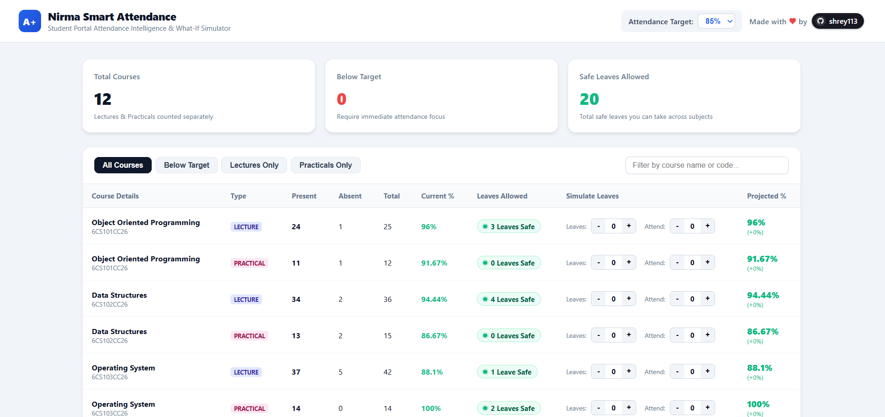

  
  <h1>Nirma Smart Attendance</h1>
  
Client-side attendance calculator and what-if leave simulator for Nirma University Student Portal.

  

    
  

---

## 1. Installation & Usage

### 🚀 Direct 1-Click Install

Install directly from the official **Chrome Web Store**:

👉 **[Click here to Install Nirma Smart Attendance](https://chromewebstore.google.com/detail/nirma-smart-attendance/onagdnciilbhdofbggenacnojlkolibe)**

Click **"Add to Chrome"** (works on Chrome, Brave, and Edge).

### 📖 How to Use
1. Open [Nirma Attendance Report](https://mis.nirmauni.ac.in/Reports/StudentAttendanceReport.aspx) and log in.
2. The extension automatically activates on the page:
   - **Floating Menu:** Click the floating pill at the bottom right corner for an instant overview popup.
   - **Course Row Badges:** Click the **Info** button on any course row to view safe leaves & use the leave simulator drawer.
   - **Full View:** Click **Full View & Leave Simulator** to view the comprehensive analytics dashboard.

*(Updates from the Chrome Web Store are installed automatically in the background).*

---

## 2. Preview

| Course Deep-Dive Drawer | Extension Popup |
| :---: | :---: |
|  |  |

| Full Intelligence Dashboard | In-Page Table Integration |
| :---: | :---: |
|  |  |

---

## 3. Privacy & Safety (100% Local — Zero API Calls)

- **Pure Client-Side Reading:** Data is parsed directly from the table HTML already rendered in your browser.
- **Zero API Calls / Zero Network Requests:** Makes **zero** fetch/HTTP/API requests to any server. Zero external servers or tracking.
- **Zero Server Footprint:** The university server only delivers the original page; all calculations and overlays execute strictly in local browser memory.
- **100% Safe & Undetectable:** Credentials, cookies, and server data are never touched, submitted, or transmitted.

---

## 4. Mobile Browser Setup (Android)

Standard mobile Chrome does not support extensions, but you can install it on Android with 1 click using **Kiwi Browser**:
1. Install **[Kiwi Browser](https://play.google.com/store/apps/details?id=com.kiwibrowser.browser)** from Google Play Store.
2. Open the **[Chrome Web Store Link](https://chromewebstore.google.com/detail/nirma-smart-attendance/onagdnciilbhdofbggenacnojlkolibe)** inside Kiwi Browser.
3. Tap **"Add to Chrome"**.
4. Open [Nirma Attendance Report](https://mis.nirmauni.ac.in/Reports/StudentAttendanceReport.aspx) in Kiwi Browser to use the extension on mobile.
