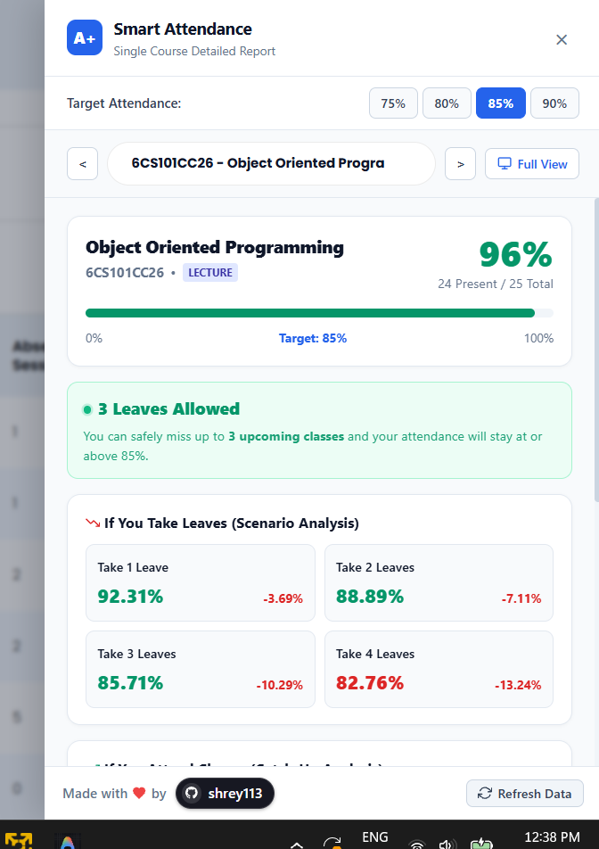
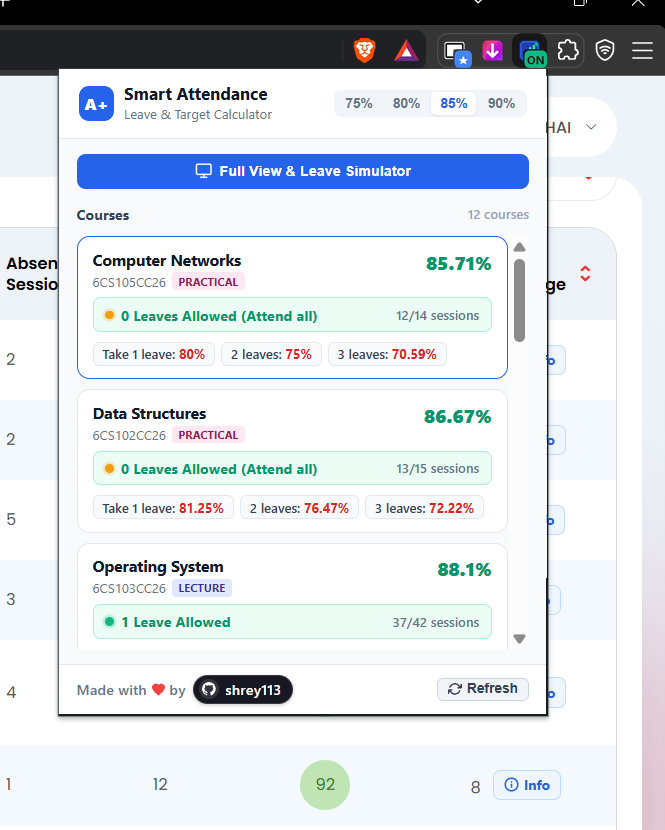

# Nirma Smart Attendance

Client-side attendance calculator and what-if leave simulator for Nirma University Student Portal.

---

## 1. How to Use & Update

### First-Time Installation
1. **Download Source Code:**
   - Click the green **Code** button at the top of this GitHub repository → **Download ZIP** (or run `git clone https://github.com/Shrey113/Nirma-Smart-Attendance.git`).
   - Extract the downloaded ZIP file anywhere on your computer.
2. **Load into Browser:**
   - Open Chrome, Brave, or Edge and go to `chrome://extensions/`.
   - Enable **Developer mode** (toggle in the top-right corner).
   - Click **Load unpacked** and select the extracted folder (`Nirma Smart Attendance`).
3. **Open Portal:**
   - Open [Nirma Attendance Report](https://mis.nirmauni.ac.in/Reports/StudentAttendanceReport.aspx) and log in.
   - Click the **Info** button on any course row to view safe leaves & use the leave simulator, or use the extension toolbar popup.

### How to Update to Latest Version
1. Download the latest code (or `git pull`) and replace the files in your existing folder.
2. Go to `chrome://extensions/` and click the **🔄 Reload** icon on the **Nirma Smart Attendance** extension card.

---

## 2. Preview

| Course Deep-Dive Drawer | Extension Popup |
| :---: | :---: |
|  |  |

| Full Intelligence Dashboard | In-Page Table Integration |
| :---: | :---: |
|  |  |

---

## 3. Privacy & Safety (100% Local — Zero API Calls)

- **Pure Client-Side Reading:** Data is parsed directly from the table HTML already rendered in your browser.
- **Zero API Calls / Zero Network Requests:** Makes **zero** fetch/HTTP/API requests to any server. Zero external servers or tracking.
- **Zero Server Footprint:** The university server only delivers the original page; all calculations and overlays execute strictly in local browser memory.
- **100% Safe & Undetectable:** Credentials, cookies, and server data are never touched, submitted, or transmitted.

---

## 4. Mobile Browser Setup (Android)

Standard mobile Chrome does not allow extensions, but you can use it on Android via **Kiwi Browser**:
1. Install **[Kiwi Browser](https://play.google.com/store/apps/details?id=com.kiwibrowser.browser)** from Google Play Store.
2. Download this repository ZIP on your phone (**Code** → **Download ZIP**).
3. In Kiwi Browser, tap **⋮ (Menu)** → **Extensions** → toggle **Developer mode** ON.
4. Tap **+(from .zip / .crx / user.js)** and select the downloaded ZIP file.
5. Open [Nirma Attendance Report](https://mis.nirmauni.ac.in/Reports/StudentAttendanceReport.aspx) in Kiwi Browser to use the extension on mobile.
