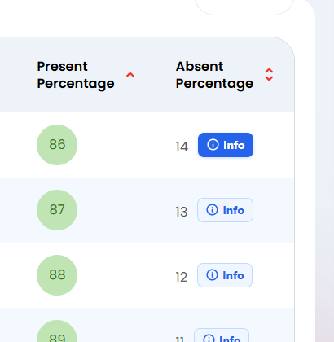

# Nirma Smart Attendance

A clean, client-side attendance intelligence calculator and leave simulator for Nirma University Student Portal.

---

## 1. How to Use It

1. **Install the Extension:**
   - Open your browser (Chrome, Brave, Edge) and go to `chrome://extensions/`.
   - Turn on **Developer mode** (toggle in the top-right corner).
   - Click **Load unpacked** and select this folder (`Nirma Smart Attendance`).

2. **Open Your Attendance Report:**
   - Navigate to the Nirma University attendance portal:
     `https://mis.nirmauni.ac.in/Reports/StudentAttendanceReport.aspx`
   - Log in and open your student attendance report.

3. **Calculate Leaves & Simulate:**
   - Click the **Info** button added next to any course row in the table to open the course deep-dive drawer.
   - Toggle target thresholds (**75%**, **80%**, **85%**, **90%**) to instantly see how many classes you can safely miss or need to attend.
   - Use the **+** and **-** steppers in the Custom Leave Simulator to project upcoming leaves with zero lag.
   - Click the extension icon in the toolbar or click **Full View** for the full analytics dashboard.

---

## 2. Preview

### Single Course Deep-Dive Drawer

### Extension Toolbar Popup

### Full Attendance Intelligence Dashboard

### In-Page Table Integration

---

## 3. Privacy & Safety (100% Local — Zero API Calls / No External Requests)

- **Pure Client-Side Reading:** All numbers are read directly from the HTML table already displayed in your browser.
- **Zero API Calls / Zero Network Requests:** The extension makes **zero** HTTP/fetch/API requests to any server. No external servers, analytics, or third-party endpoints are ever contacted.
- **Zero Server Footprint:** The university server only delivers the original attendance web page; all calculations, leave projections, and UI overlays happen entirely inside your local browser session.
- **Safe & Undetectable:** Nothing is transmitted, submitted, or modified on the server. Your login credentials, session cookies, and records remain 100% untouched and secure.
